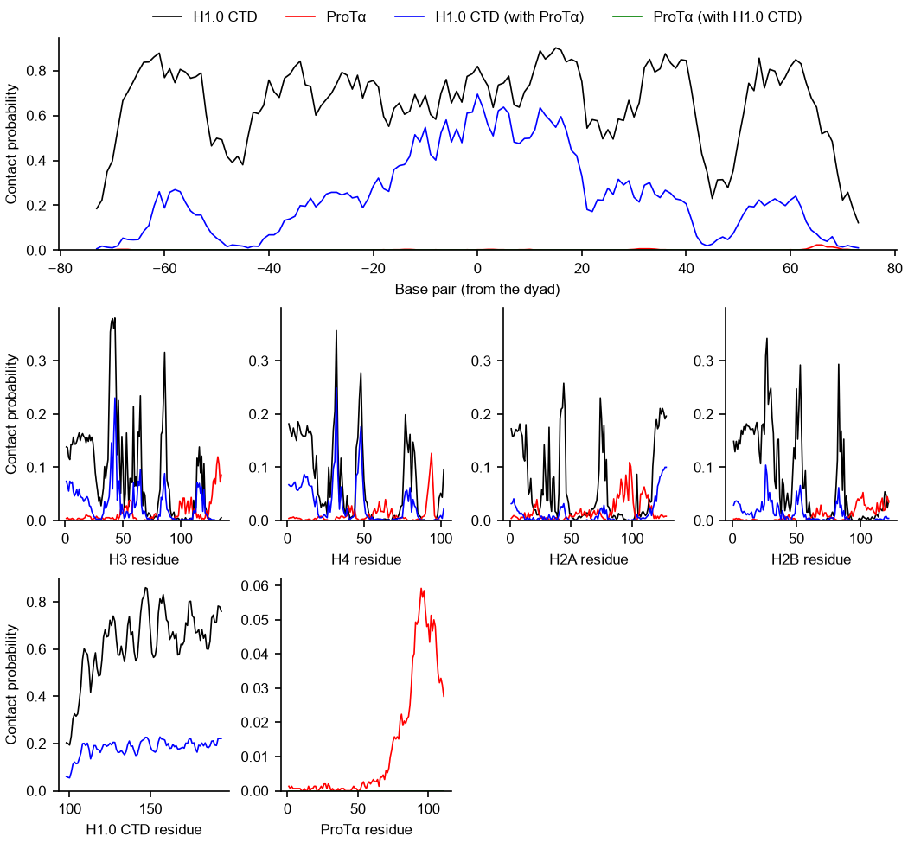

# A nucleosome from the PDB, with disordered proteins around it

This demo starts PIMMS from an experimental structure. `pdb2pimms` turns the nucleosome core particle of PDB entry 1KX5 into a restart file and a freeze file, the nucleosome is held frozen except for its histone tails, which move, and disordered proteins added with `EXTRA_CHAIN` move around it. A short analysis script then shows where on the nucleosome each protein binds, with which of its residues, and where the tails go.

## The system

* **The nucleosome core particle**, PDB 1KX5 (Davey et al., *J. Mol. Biol.* 319, 1097-1113, 2002; 1.9 A): two copies each of histones H3, H4, H2A and H2B, with their tails, wrapped by 147 bp of DNA. `pdb2pimms` makes it 10 chains of 1,268 beads (one per residue) and fits them to the lattice with an RMSD of 2.04 A.
* **The histone tails**, which are left free to move: residues 1-26 of H3, 1-17 of H4, 1-20 of H2B, and 1-11 and 118-128 of H2A, in both copies, 170 residues in all (numbered as in 1KX5). These are the tails Biswas et al. truncated in their simulations of 1KX5, cut at known trypsin cleavage sites (*PLoS Comput. Biol.* 7, e1002279, 2011). The rest of each histone stays frozen in its crystal position, including the residues between each cut and the histone fold (in H3, residues 27-43; its first helix starts at residue 44).
* **The H1.0 C-terminal domain (H1.0 CTD)**: residues 98-194 of human linker histone H1.0 (UniProt P07305), everything after its globular H15 domain. 97 residues, 42 of them lysine or arginine and 3 aspartate or glutamate.
* **Prothymosin alpha (ProTα)**: human prothymosin alpha (UniProt P06454), all 111 residues, 54 of them aspartate or glutamate and 10 lysine or arginine.

H1 and ProTα are a famous pair of disordered proteins. They bind each other with picomolar affinity while both stay disordered (Borgia et al., *Nature* 555, 61-66, 2018), and ProTα invades the complex of H1 with the nucleosome and displaces H1 by competitive substitution, vastly accelerating its dissociation (Heidarsson et al., *Nat. Chem.* 14, 224-231, 2022). The demo runs each protein on its own with the nucleosome, and then both together:

| Directory | Added with `EXTRA_CHAIN` |
|---|---|
| `H1_CTD/` | four copies of the H1.0 CTD |
| `ProTa/` | four copies of ProTα |
| `H1_CTD_ProTa/` | four copies of each |

Each run has the nucleosome in a periodic box 90 sites (328 A) on a side, so each protein is at about 0.19 mM and the nucleosome at 47 µM.

## Files

| File | What it is |
|---|---|
| `1kx5.cif.gz` | PDB entry 1KX5, as downloaded from the RCSB (`https://files.rcsb.org/download/1KX5.cif.gz`) |
| `params.prm` | The parameter file: the protein parameters that ship with PIMMS, plus the DNA bead types (see below) |
| `H1_CTD/KEYFILE.kf`, `ProTa/KEYFILE.kf`, `H1_CTD_ProTa/KEYFILE.kf` | The three runs |
| `analyze_contacts.py` | Where the proteins touch the nucleosome and each other, and where the tails go |
| `reset.sh` | Deletes everything the commands below write, to run the demo again from the start |

## Running it

From this directory:

```
pdb2pimms 1kx5.cif.gz \
    --mobile A:1-26 --mobile E:1-26 \
    --mobile B:1-17 --mobile F:1-17 \
    --mobile C:1-11 --mobile C:118-128 --mobile G:1-11 --mobile G:118-128 \
    --mobile D:1-20 --mobile H:1-20
(cd H1_CTD && PIMMS -k KEYFILE.kf)
(cd ProTa && PIMMS -k KEYFILE.kf)
(cd H1_CTD_ProTa && PIMMS -k KEYFILE.kf)
python analyze_contacts.py
```

Each run takes about three minutes on one core; they are independent, so they can run side by side. The analysis needs matplotlib, which PIMMS itself does not (`pip install matplotlib`).

To run the demo again from the start, first delete what the commands wrote:

```
./reset.sh -n    # list what would be deleted
./reset.sh
```

It deletes the files `pdb2pimms`, PIMMS and `analyze_contacts.py` write, each by its exact name, and keeps the inputs. If a run directory holds anything else (a file of your own, say), it leaves it in place, lists it and exits with status 1. Run it too if you converted the structure with an earlier version of this demo, which froze the tails: `pdb2pimms` does not replace files it has written unless given `--overwrite`.

## Step by step

### 1. Converting the structure

```
$ pdb2pimms 1kx5.cif.gz \
    --mobile A:1-26 --mobile E:1-26 \
    --mobile B:1-17 --mobile F:1-17 \
    --mobile C:1-11 --mobile C:118-128 --mobile G:1-11 --mobile G:118-128 \
    --mobile D:1-20 --mobile H:1-20
Wrote 1kx5_restart.pimms: 10 chain(s), 1268 beads, box 39 48 26, fit RMSD 2.04 A
Wrote 1kx5_report.md
Wrote 1kx5_freeze.txt: freezes 1098 of 1268 beads (2 chain(s) entirely, 8 partly, 0 left free); the free beads of a partly frozen chain move by MOVE_CRANKSHAFT only
Bead types the parameter file must define (23): A C D E F G H I K L M N P Q R S T V Y a c g t
```

(the paths are printed in full). Each `--mobile` names one tail by the structure's own chain ID and residue numbers: chains A and E are H3, B and F are H4, C and G are H2A, and D and H are H2B. `1kx5_report.md` describes the conversion: every chain, how well it fits the lattice, what was left out (the waters and the manganese and chloride ions), the free residues of every chain and the keyfile lines for using the files.

The freeze file freezes the two DNA strands whole, with `C` lines, and each histone except its tails, with `B` lines, which list the frozen beads by their index along the chain, counted from 0:

```
C 1   # I:DA-73-DT73, 147 bead(s)
C 2   # J:DA-73-DT73, 147 bead(s)
B 3  26-134  # A:ALA1-ALA135: 109 of 135 bead(s) frozen; free: beads 0-25 (A:ALA1-ARG26)
B 4  17-101  # B:SER1-GLY102: 85 of 102 bead(s) frozen; free: beads 0-16 (B:SER1-ARG17)
B 5  11-116  # C:SER1-LYS128: 106 of 128 bead(s) frozen; free: beads 0-10 (C:SER1-ARG11), beads 117-127 (C:LYS118-LYS128)
B 6  20-121  # D:ALA1-LYS122: 102 of 122 bead(s) frozen; free: beads 0-19 (D:ALA1-LYS20)
...
```

### 2. Completing the parameter file

The report lists the 23 bead types the parameter file has to define: the 19 amino acids in the histones (they have no tryptophan) and the four DNA nucleotides, which `pdb2pimms` writes in lower case (`a`, `c`, `g`, `t`) so that they never share a bead type with an amino acid. The protein parameters that ship with PIMMS (`pimms/data/gcf_rje23_v14.prm`, made for `TEMPERATURE : 50`) define the amino acids but not DNA, so `params.prm` is that file unchanged followed by a section for the nucleotides.

Each nucleotide carries one phosphate, so each is modelled as a single negative charge: it takes the aspartate (`D`) charge terms with `K`, `R`, `D` and `E` (short, long and super-long range), the `D`-`D` terms with the other nucleotides, the `D` solvation energy, and no interaction with anything else. This is a deliberately simple DNA model for a demo, not a validated one.

### 3. The keyfiles

Each keyfile loads the restart file and the freeze file and adds the disordered proteins with `EXTRA_CHAIN`. PIMMS numbers added chains after the restart file's, from chainID 11, so the freeze file (chainIDs 1-10) still freezes exactly the nucleosome, less its tails.

Only the crankshaft move (`MOVE_CRANKSHAFT`) moves the free beads of a partly frozen chain, one bead at a time. Every move that displaces a whole chain or a segment of one leaves the histones alone, because it would have to move their frozen beads too. The crankshaft takes 70% of the steps here, and each of its 5,000 sub-moves picks a bead from all the free ones, the tails' and the added proteins' alike. The start-up log lists the eight partly frozen histones and their frozen beads. The tails start where the crystal has them, mostly reaching out from the particle (14% of their residues touch the DNA), and settle within the 5,000 equilibration steps: in each fifth of the production run, the fraction touching the DNA is within 0.03 of its average over the whole run.

The restart file's box (39 x 48 x 26) is centred in the run's 90 x 90 x 90 periodic box. The box has to be this large because it is periodic: the nucleosome is 153 A long, and in a smaller box the proteins can bridge it and its periodic image, which turns the system into a dense array of nucleosomes. PIMMS's warning that a cluster percolates the box is the sign of that (at 60 sites it appears).

The cluster moves are left out, because every cluster that touches the nucleosome contains a frozen chain and would be rejected. `SAVE_EQ : False` keeps the equilibration out of `traj.xtc`, which is what `analyze_contacts.py` expects.

`ENERGY.dat` holds large positive energies. Every interaction term is negative; the total is positive because of the angle penalty (the `ANGLES` term PIMMS prints with each energy check, about +109,000 at the end of the `H1_CTD` run), which the frozen histones carry because their crystal conformation is far from straight on the lattice. Their angle penalty and the interactions of the frozen part of the nucleosome with itself are the same in every frame, so only changes in the energy mean anything.

### 4. Analysing the contacts

`analyze_contacts.py` loads each run with `lemonade`, PIMMS's analysis package, and counts, in every production frame, which nucleosome beads are touched by a bead of an added protein. Two beads touch when they are Chebyshev neighbours (at most one lattice step apart along every axis), the shell over which PIMMS's short-range interactions act. In the run with both proteins it also counts which copies touch a copy of the other protein. Because the tails move, it finds them again in every frame. It maps the beads back to residues by converting the structure again in memory, reads which beads are frozen from the freeze file, and refuses to run if a frozen bead is not exactly where the restart file put it in every frame, or if none of the beads the freeze file leaves free ever moves (a run made with the tails frozen as well). For each histone tail it also prints the fraction of its residues touching the DNA.

For each protein in each run it writes, into the run's directory (`<name>` is `H1_CTD` or `ProTa`):

| File | Contents |
|---|---|
| `contacts_nucleosome_<name>.csv` | For every nucleosome residue, the fraction of frames in which the protein touches it |
| `contacts_<name>.csv` | For every residue of the protein, the fraction of frames (over all copies) in which it touches the nucleosome |
| `1kx5_contacts_<name>.pdb` | 1KX5 with each residue's contact fraction as its B-factor |

and it writes `nucleosome_contacts.pdf` here. To colour the nucleosome by contact in PyMOL:

```
load H1_CTD/1kx5_contacts_H1_CTD.pdb
spectrum b, white_red, minimum=0, maximum=1
```

To watch a run, load its trajectory onto its topology, e.g. `vmd H1_CTD/START.pdb H1_CTD/traj.xtc`.

## What you should see

With the seeds in the keyfiles, `analyze_contacts.py` reports:

| Protein | Fraction of frames each copy touches the nucleosome | Share of its contacts on the DNA | Residues per copy touching the nucleosome |
|---|---|---|---|
| H1.0 CTD alone | 1.00 1.00 1.00 1.00 | 80% | 60 |
| ProTα alone | 0.26 0.03 0.04 0.08 | 4% | 1.4 |
| H1.0 CTD with ProTα | 0.00 0.00 1.00 0.00 | 83% | 18 |
| ProTα with H1.0 CTD | 0.00 0.00 0.00 0.00 | - | 0 |

and, for the histone tails, the fraction of their residues touching the DNA (the two copies of each tail averaged):

| Run | H3 | H4 | H2A N-terminal | H2A C-terminal | H2B | Every tail |
|---|---|---|---|---|---|---|
| `H1_CTD` | 0.39 | 0.35 | 0.36 | 0.42 | 0.43 | 0.39 |
| `ProTa` | 0.65 | 0.65 | 0.64 | 0.56 | 0.65 | 0.63 |
| `H1_CTD_ProTa` | 0.61 | 0.56 | 0.63 | 0.50 | 0.63 | 0.59 |



* **The H1.0 CTD coats the DNA, and pushes the tails off it.** Every copy stays bound for the whole run, 80% of its contacts are with the DNA, and on average 60 of its 97 residues touch the nucleosome at any moment, mostly from the lysine-rich stretch after residue 110 (bottom left). It covers the whole length of the DNA (top, black). The tails are basic too, and compete with it for the DNA: with the H1.0 CTD on the nucleosome, 39% of the tail residues touch the DNA, against 63% with ProTα, which hardly touches the nucleosome (below). The H1.0 CTD touches the tails as well (middle row, black: the left end of each histone and the right end of H2A).
* **ProTα hardly touches the nucleosome.** Its copies touch it in 3% to 26% of frames, and on average only 1.4 of a copy's 111 residues touch it. It is strongly acidic, so it stays off the DNA (4% of its contacts), and the free tails, which it could bind, lie on the DNA instead. When it does touch the nucleosome it is mostly with its last 30 residues (bottom right), spread over the surface of the histones (middle row, red).
* **Together, ProTα holds H1 off the nucleosome.** ProTα spends 99% of the run bound to the H1.0 CTD and never touches the nucleosome. Three of the four H1.0 CTD copies spend the whole run in complexes with ProTα, away from the nucleosome, and the number of H1.0 CTD residues touching the nucleosome drops from 60 to 18 per copy (top, blue against black). With less H1.0 CTD on the DNA, more of the tails lie on it (59%).

Three more runs of each with other seeds (11, 12 and 13) give the same picture. Without ProTα, every H1.0 CTD copy is bound throughout, 60 residues per copy touch the nucleosome and 39-40% of the tail residues touch the DNA. ProTα alone touches the nucleosome in 1% to 6% of frames, with 64-65% of the tail residues on the DNA. Together, one or two of the four H1.0 CTD copies are on the nucleosome, with 18 to 34 residues per copy touching it and 55-60% of the tail residues on the DNA. In two of these runs a copy touches the nucleosome and ProTα at once in 10% and 26% of H1.0 CTD copy-frames, the kind of ternary complex a competitive substitution passes through.

The free tails matter most for ProTα. With the tails frozen where the crystal has them, mostly reaching out from the particle (convert without the `--mobile` options), ProTα binds the H3 tails: its copies touch the nucleosome in 15% to 84% of frames, and 77% of its contacts are with H3, almost all with its N-terminal tail.

Treat these numbers as a qualitative picture, not as binding constants. The exchange is slow: every H1.0 CTD copy in these runs but one is on the nucleosome in every frame or in none, so which partner a copy meets first matters as much as the balance between them (see the limitations below).

PIMMS warns, once per chain, when a chain first stretches across more than half the box. ProTα is very expanded (54 of its 111 residues are acidic), and copies reach across up to 54 of the 90 sites, which still leaves 36 empty sites between a copy and its own periodic image.

## Limitations

* Only the tails as Biswas et al. cut them move. The residues between each cut and the histone fold, the folded histones and the DNA stay frozen in their crystal positions, so the DNA cannot unwrap and the core cannot breathe. Freeing a longer stretch of a tail is only a matter of the `--mobile` ranges.
* The tails move only by single-bead crankshaft moves. That is enough for tails of 11 to 26 residues, which settle within the equilibration, but would be slow for much longer free segments.
* The DNA is a string of negative charges, with no shape-dependent or base-specific interactions.
* There is no linker DNA, so H1 cannot bind the way it does on chromatin, across the dyad and the two linkers.
* Electrostatics reach only three lattice sites (11 A), with no dependence on salt.
* An H1.0 CTD copy that has bound rarely leaves within a run, so the per-copy numbers depend on the seed. For numbers rather than a picture, run longer or average several seeds.
